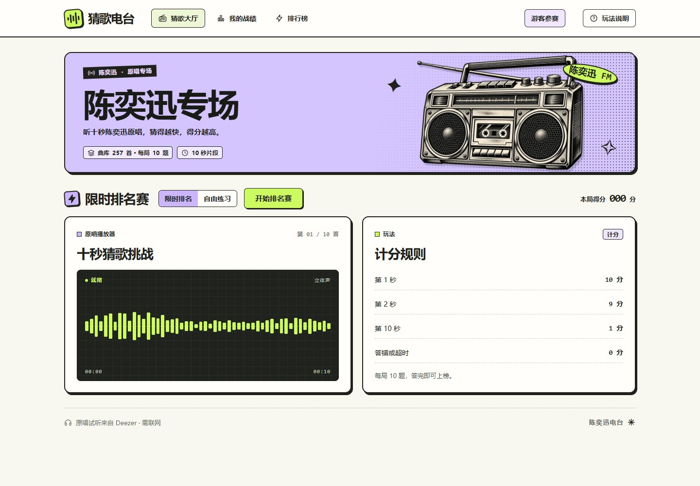

# 猜歌电台 · 陈奕迅专场

听十秒陈奕迅原唱，从四个歌名里选出答案。答得越快，得分越高。

- 在线试玩：<https://caige-radio.onrender.com>
- 曲库：250+ 首，每题只播放 Deezer 30 秒试听中的 10 秒
- 技术栈：原生 JavaScript、Web Audio API、Node.js 22、SQLite / Turso、Render



## 玩法

排名赛每局 10 题，每题限时 10 秒。第 1 秒内答对得 10 分，第 2 秒得 9 分，依次递减；答错、放弃和超时均为 0 分。答完即可进入全站排行榜。

练习模式每局 5 首，可以暂停、重听，猜中一题得 100 分；练习成绩保存在本机。

## 实现要点

- **答案不下发**：排名赛题目、选项和计分都由服务端生成；客户端只有在 `/api/start` 之后才拿到选项。
- **服务端计时**：`start` 记录起始时间，`answer` 以服务端收到答案的时间计分，并做幂等与版本号乐观锁。
- **音频预取**：当前题播放时预取下一题的试听，缩短连续作答的等待。
- **只拉需要的片段**：试听是 128 kbps CBR，客户端按字节范围只下载答案附近约 13 秒，而不是整段 30 秒；Range 被代理拒绝时自动回退整段。
- **RTT 起跑补偿**：客户端上报测得的 RTT，服务端按 `RTT / 2 + 300ms`（400–2000ms）安排 `startAt`。慢网用户不会因为响应慢而少听开头；这个值只会推迟起跑，不会增加答题时间。
- **断线续局**：同一 Cookie 再次进入会回到当前局，已得分数从服务端同步。
- **移动端适配**：底部导航、320px 小屏布局、触屏设备不自动跳题，避免抢走阅读答案和点链接的时间。
- **可访问性**：原生 `<dialog>`、可见焦点、移动端小屏隐藏底栏、隐藏的 h1 保留在无障碍树中；主要页面通过 axe-core 扫描。

## 本地运行

需要 Node.js >= 22.5（使用内置 `node:sqlite`）。

```bash
npm ci
npm run build
npm start          # http://localhost:8080
```

开发模式：

```bash
npm run dev        # http://127.0.0.1:18746
```

测试：

```bash
npm test
```

## 部署

仓库包含 `render.yaml`，Render 会执行 `npm ci --omit=dev && node scripts/build.mjs` 后运行 `npm start`。

### 启用 Turso 持久化（推荐）

未配置时服务自动回退到本地 SQLite（免费实例重新部署会重置）。配置后启动会连接 Turso 并自动执行 `drizzle/` 里的迁移：

```bash
# 1. 创建数据库（也可在 Turso 控制台操作）
turso db create caige-radio
turso db show caige-radio --url
turso db tokens create caige-radio

# 2. 在 Render 的 Environment 中添加：
#    TURSO_DATABASE_URL=libsql://...
#    TURSO_AUTH_TOKEN=...
```

`TURSO_AUTH_TOKEN` 只放在 Render 环境变量里，不要提交到仓库。

需要注意：

- 免费实例的文件系统不是持久的。默认 SQLite 文件在实例本地，重新部署或重启会重置排行榜；配置 Turso 后榜单跨部署保留。
- `keepalive` 工作流只在北京时间 08:00–24:00 每 10 分钟唤醒一次，夜间让实例休眠。Render 免费额度是 workspace 共享的 750 小时/月，24/7 保活会占掉几乎全部额度。
- 免费实例无流量约 15 分钟后休眠，唤醒可能需要约 60 秒。
- 首次启动会写入一条演示成绩，避免空榜；可在 `server/start.mjs` 的 `DEMO_SCORES` 中修改或删除。

## 项目结构

```
dist/              页面、样式、客户端脚本、曲库和 OG 封面
server/api.mjs     出题、计时、计分和排行榜 API
server/start.mjs   Node HTTP 服务器与本地 SQLite 启动
scripts/build.mjs  把静态资源和 API 打包成可直接运行的 worker
scripts/catalog.py 曲库刷新脚本（需要 uv / ffmpeg / ONNX Runtime）
scripts/local-db.mjs 本地 SQLite 的 D1 风格适配层
scripts/turso-db.mjs Turso/libSQL 的 D1 风格适配层（自动迁移）
tests/             计时、多玩家排行榜与 Turso 适配器测试
```

## 数据与版权

原唱试听来自 Deezer，页面会标注来源。曲库脚本只保存 track id、显示标题和片段起点，不保存音频文件。

这是一个非官方的粉丝向作品，与陈奕迅及其唱片公司无关；艺人名、歌曲名和录音版权归各自权利人所有。

代码以 MIT License 发布，音频和曲名不包含在该许可范围内。
